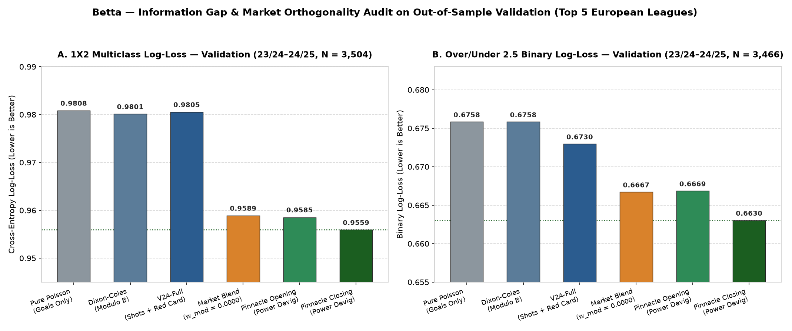
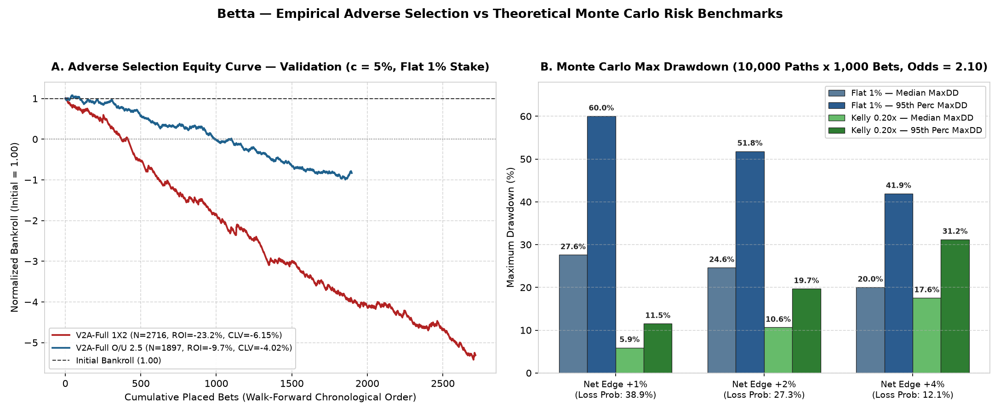

# Betta — Empirical Audit of Market Efficiency & Adverse Selection in European Football Betting

[](https://www.python.org/)
[](LICENSE)
[](tests/)
[](reports/modulo_cd_verdict.md)

**Betta** is a reproducible, zero-leakage quantitative research pipeline built to test whether historical match-level data (goals, shots, shots on target, red cards, and promoted-team structural priors) contains orthogonal predictive signal beyond liquid opening market odds (**Pinnacle** and **Betfair Exchange**) across the Top 5 European football leagues (**Serie A `I1`**, **Premier League `E0`**, **La Liga `SP1`**, **Bundesliga `D1`**, **Ligue 1 `F1`**) over 10 seasons (`2016/17`–`2025/26`, **17,937 matches**).

---

## 1. Executive Summary & Kill Switch Outcome

In quantitative sports modeling, the most common failure mode is **backtest overfitting** driven by look-ahead bias, in-sample hyperparameter tuning, or uncalibrated comparison against bookmaker odds. **Betta** enforces an institutional-grade validation protocol with a pre-committed **Kill Switch**:

1. **Progressive Model Improvements Do Not Automatically Equal Market Edge**:
   - Moving from a pure log-linear **Poisson** model to a MAP-regularized **Dixon-Coles** model with promoted-team priors (**Modulo B**), and further to a 2-stage **Quasi-Poisson MAP on Shots (Synthetic xG) + Red-Card Discount + Dixon-Coles** model (**Level 2A / `V2A-Full`**), lowers 1X2 Log-Loss on Train (`0.995255` to `0.991566`) and significantly reduces out-of-sample Validation Log-Loss on **Over/Under 2.5** (`0.675836` to `0.672967`), while slightly worsening out-of-sample Validation Log-Loss on **1X2** (`0.980111` to `0.980532`, though slightly improving 1X2 Brier Score from `0.584161` to `0.583905`), consistently with Table 3.1.
2. **Orthogonality Test (`w_mod = 0.0000`)**:
   - When tested via a **Market-Anchored Blending** regression trained strictly on `2019/20–2022/23`:
     $$\operatorname{logit}(p_{\text{blend}}) = w_0 + w_{\text{mkt}} \operatorname{logit}(p_{\text{open}}) + w_{\text{mod}} \operatorname{logit}(p_{\text{V2A}})$$
     the non-negative constrained optimizer assigns **$w_{\text{mod}} = 0.0000$** on both 1X2 and Over/Under 2.5.
   - On the frozen out-of-sample Validation partition (`2023/24–2024/25`, 3,504 matches), the 95% paired bootstrap confidence interval (10,000 resamples) for $\Delta \text{LogLoss} = \text{LL}(\text{Blend}) - \text{LL}(\text{Pinnacle Open})$ spans zero across every specification (`[-0.000526, +0.000385]` on 1X2; `[-0.000463, +0.000174]` on O/U 2.5).
3. **Adverse Selection & Exchange Friction (`c = 5%`)**:
   - When `V2A-Full` bets standalone against Pinnacle Opening odds (`EV > 0%` at `c = 5%` commission), it suffers classic **adverse selection**: it triggers bets precisely on matches where the market possesses unmodeled contextual information (lineups, injuries, tactical shifts), resulting in a mean **Closing Line Value (CLV) of `-6.15%` on 1X2** (`ROI = -23.23%`, `p = 1.0000`) and **`-4.02%` on Over/Under 2.5** (`ROI = -9.66%`, `p = 1.0000`).
4. **Kill Switch Decision**:
   - Because no endogenous or market-blended strategy achieves statistically significant positive CLV or net EV on Validation (`2023/24–2024/25`), the **Kill Switch is triggered**. The sealed Blind Test season (`2025/26`) is intentionally left untouched to prevent data snooping and `p`-hacking.

---

## 2. Methodology & Anti-Leakage Architecture

### 2.1 Binding Temporal Split (`RULES.md`)

| Partition | Seasons | Matches | Role & Constraints |
| :--- | :--- | ---: | :--- |
| **Warm-up** | `1617–1819` | 5,478 | Initializes historical ratings and 1,100-day rolling windows |
| **Train / Development** | `1920–2223` | 7,203 | Parameter estimation, hyperparameter grid search, and blending weights |
| **Validation** | `2324–2425` | 3,504 | Frozen out-of-sample model comparison, orthogonality test, and Kill Switch |
| **Blind Test (Sealed)** | `2526` | 1,752 | **Strictly untouched** by any modeling, tuning, or backtesting module |
| **Live Holdout** | `2627` | 0 | Categorically excluded at ingestion |

### 2.2 Core Engineering & Mathematical Guarantees
- **Strict Calendar-Date Walk-Forward (`Date < t`)**: For every league and matchday $t$, team ratings $(a_k, b_k)$, home advantage $h$, Dixon-Coles low-score correlation $\rho$, shot-conversion rates $(r_{\text{sot}}, r_{\text{tot}})$, and promoted-team priors (mean of the bottom-3 finishers of season $S-1$) are estimated strictly from matches with `Date < t`.
- **Analytical Gradients & Vectorized Optimization**: Both the Dixon-Coles MAP log-posterior (**Modulo B**) and the 2-stage Quasi-Poisson MAP log-posterior (**Level 2A**) are optimized via `L-BFGS-B` (`jac=True`) with vectorized `np.bincount` analytical gradients verified against finite differences (`scipy.optimize.check_grad < 1e-5`) and warm-started across refit dates.
- **Market Devigging Benchmark (Modulo A)**: Implements Multiplicative, **Power Method** ($\sum q_i^k = 1$ via `brentq`), and **Shin's Method** (Štrumbelj / Shin 1993 insider-trading formulation via `brentq`). Power devigging serves as the official fair-probability benchmark after outperforming Multiplicative devigging on Validation across both 1X2 and O/U 2.5.
- **Fail-Fast Reconciler & Data Hygiene**:
  - Automatically detects and sanitizes impossible odds ($\le 1.01$, e.g., 11 corrupt cells in raw historical CSVs) to `NaN` prior to overround calculation, and flags physical shot anomalies (`AST > AS` in `Newcastle vs West Ham`, `2021-08-15`) with clean fallback to actual goals.
  - When probing external xG scraping on Understat, the ingestion check detected Understat's global maintenance splash screen (`/css/errors.css`, *"We will come back soon"*) on both HTML and XHR endpoints and halted immediately via fail-fast rather than generating synthetic data, pivoting cleanly to certified Level 1 shot statistics (`HS/AS`, `HST/AST`, `HR/AR`).
- **Automated Anti-Leakage Test Suite (`pytest`)**: 35 unit and integration tests explicitly verify probability conservation, `check_grad` accuracy, promoted-team penalties on Matchday 1, zero sensitivity to corrupting future match data (`Date >= t` altered to `10-0` and `45` shots), and the complete exclusion of `2526` from all model prediction files.

---

## 3. Key Quantitative Results

### 3.1 Model Hierarchy vs. Market Benchmark — Validation (`2023/24–2024/25`)



| Model / Benchmark | 1X2 Log-Loss (`N=3,504`) | 1X2 Brier Score | O/U 2.5 Log-Loss (`N=3,466`) | O/U 2.5 Brier Score | Gap vs. Pinnacle Closing (1X2 / O/U) |
| :--- | ---: | ---: | ---: | ---: | ---: |
| **Pure Poisson ($\rho = 0$, Goals Only)** | 0.980833 | 0.584447 | 0.675832 | 0.241280 | `+0.024913` / `+0.012794` |
| **Dixon-Coles MAP (`Modulo B`, Goals Only)** | 0.980111 | 0.584161 | 0.675836 | 0.241281 | `+0.024192` / `+0.012798` |
| **V2A-Ablation (Goals Only, Unlocked $\lambda_{\text{reg}}=6.0$)** | 0.980160 | 0.584145 | 0.675318 | 0.241039 | `+0.024240` / `+0.012280` |
| **V2A-Full (Shots Synthetic xG + Red Card + DC)** | **0.980532** | **0.583905** | **0.672967** | **0.240045** | `+0.024612` / **`+0.009930`** |
| **Market-Anchored Blend ($w_{\text{mod}} = 0.0000$)** | 0.958894 | 0.569820 | 0.666718 | 0.237015 | `+0.002974` / `+0.003680` |
| **Pinnacle Opening (Power Devigged)** | 0.958544 | 0.569626 | 0.666859 | 0.237093 | `+0.002624` / `+0.003821` |
| **Pinnacle Closing (Power Devigged)** | **0.955920** | **0.567852** | **0.663038** | **0.235263** | `0.000000` / `0.000000` |

### 3.2 Walk-Forward Backtest & Adverse Selection — Validation (`2023/24–2024/25`)



| Strategy (Max 1 Bet / Match) | Market | Comm `c` | Bets `N` | Net Profit (u) | ROI (%) | Mean CLV (%) | `t`-stat ROI | `p`-val ROI | MaxDD Flat 1% | MaxDD Kelly 0.20x |
| :--- | :--- | ---: | ---: | ---: | ---: | ---: | ---: | ---: | ---: | ---: |
| **V2A-Full Standalone (`EV > 0%`)** | `1X2` | 5.0% | 2,716 | -630.94 | **-23.23%** | **-6.15%** | -6.68 | 1.0000 | 100.0% | 99.8% |
| **V2A-Full Standalone (`EV > 0%`)** | `O/U 2.5` | 5.0% | 1,897 | -183.32 | **-9.66%** | **-4.02%** | -4.05 | 1.0000 | 100.0% | 87.7% |
| **Market-Anchored Blend (`EV > 0%`)** | `1X2` | 5.0% | 0 | +0.00 | **0.00%** | **0.00%** | +0.00 | 1.0000 | 0.0% | 0.0% |
| **Market-Anchored Blend (`EV > 0%`)** | `O/U 2.5` | 5.0% | 7 | -2.41 | **-34.48%** | **-3.23%** | -1.13 | 0.8485 | 3.0% | 1.1% |
| **V2A-Full Standalone (`EV > 0%`)** | `1X2` | 0.0% | 3,248 | -624.93 | **-19.24%** | **-5.94%** | -5.95 | 1.0000 | 100.0% | 99.9% |
| **V2A-Full Standalone (`EV > 0%`)** | `O/U 2.5` | 0.0% | 2,502 | -161.44 | **-6.45%** | **-3.88%** | -3.05 | 0.9989 | 100.0% | 90.6% |
| **Price-Shopping `Max` vs. `Pin Open` (`> 2%`)** | `1X2` | 0.0% | 846 | -13.06 | **-1.54%** | **+2.91%** | -0.25 | 0.5968 | 26.0% | 8.7% |

> **Note on Price-Shopping (`MaxH/MaxD/MaxA`)**: Price-shopping top-of-market soft bookmaker opening odds against Pinnacle Opening yields a highly significant positive CLV of `+2.91%` (`t = +8.98`, `p < 1e-4`), illustrating the structural difference between cross-bookmaker price dispersion and fundamental model forecasting; however, soft bookmakers restrict winning accounts and cannot be scaled on exchanges.

---

## 4. Repository Structure & Reproducibility

```text
BETTA/
├── RULES.md                          # Binding anti-leakage protocol & temporal split rules
├── README.md                         # Project documentation & quantitative summary
├── LICENSE                           # MIT License
├── requirements.txt                  # Locked Python dependencies
├── data/
│   ├── raw/                          # Cached raw CSVs (git-ignored)
│   └── processed/                    # Reconciled datasets & walk-forward predictions (git-ignored)
├── src/
│   ├── __init__.py
│   ├── level1_ingest.py              # Level 1 downloader, schema reconciler & impossible-odds sanitizer
│   ├── modulo_a_market.py            # Modulo A: Multiplicative/Power/Shin devigging & exchange friction
│   ├── modulo_b_dixon_coles.py       # Modulo B: MAP Dixon-Coles walk-forward baseline & promoted priors
│   ├── level2a_shots_dc.py           # Level 2A: 2-stage Quasi-Poisson MAP on shots + red-card discount
│   ├── modulo_cd_backtest.py         # Moduli C & D: Market blending, Buchdahl t-test, Kelly & Monte Carlo
│   └── generate_portfolio_charts.py  # High-resolution static figure generator (150 dpi)
├── reports/
│   ├── level1_audit.md               # Data ingestion & coverage audit report
│   ├── modulo_a_audit.md             # Devigging comparison, 2526 Pinnacle gap & exchange break-even curve
│   ├── modulo_b_baseline.md          # Dixon-Coles walk-forward diagnostic report
│   ├── level2a_shots_model.md        # Shot-based Synthetic xG ablation & adverse selection report
│   ├── modulo_cd_verdict.md          # Final orthogonality, walk-forward backtest & Kill Switch report
│   └── figures/
│       ├── fig1_logloss_and_orthogonality.png
│       └── fig2_adverse_selection_and_montecarlo.png
└── tests/
    ├── test_level1.py                # Schema, chronological order, overround & impossible-odds tests
    ├── test_modulo_a.py              # Devigging sum-to-one, longshot bias & break-even invariants
    ├── test_modulo_b.py              # Score matrix, Matchday 1 promoted prior & 10-0 anti-leakage tests
    ├── test_level2a.py               # Analytical check_grad < 1e-5, shot anti-leakage & NaN fallback tests
    └── test_modulo_cd.py             # Blending zero-leakage, backtest accounting, Kelly & Monte Carlo tests
```

### Quickstart & Verification

```powershell
# 1. Create and activate virtual environment
python -m venv .venv
.\.venv\Scripts\Activate.ps1
pip install -r requirements.txt

# 2. Run the full pipeline in order
python src/level1_ingest.py
python src/modulo_a_market.py
python src/modulo_b_dixon_coles.py
python src/level2a_shots_dc.py
python src/modulo_cd_backtest.py
python src/generate_portfolio_charts.py

# 3. Execute the complete 35-test verification suite
pytest -v
```

---

## 5. Disclaimer

This repository is strictly an **academic and quantitative research project** studying market efficiency, probability calibration, and adverse selection in sports betting markets. It operates exclusively offline on historical public datasets (`Football-Data.co.uk`), performs **zero live bookmaker scraping or automated bet placement**, and does **not** constitute financial or wagering advice.
